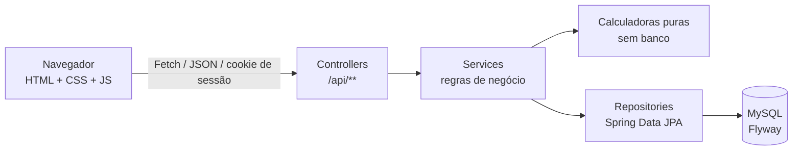

# Arquitetura

## Visão geral
Aplicação monolítica em camadas. O navegador carrega páginas estáticas (`src/main/resources/static`) e conversa com a API REST do mesmo servidor (mesma origem: sem CORS).

## Pacotes (`com.nivora.nivora`)
| Pacote | Responsabilidade |
|---|---|
| `usuario` | cadastro, login, perfil de estudo, limite de tentativas de login |
| `curso`, `instituicao` | catálogo de cursos e instituições |
| `personalizacao` | prioridades por área (`CalculadoraPrioridades`) |
| `plano` | cronograma semanal (`GeradorPlanoSemanal`) |
| `questao` | questões, simulados, respostas, seleção sem repetição (`SeletorDeQuestoes`), cadastro por ADMIN |
| `desempenho` | desempenho, sequência, XP, conquistas (`CalculadoraProgresso`) |
| `redacao` | redações, autoavaliação, análise estrutural (`AnaliseEstrutural`) |
| `metricas` | totais agregados para a avaliação (ADMIN) |
| `security`, `config` | Spring Security, tratamento de erros |

## Decisões
- **Calculadoras puras** (`Calculadora*`, `Gerador*`, `Seletor*`, `Analise*`): recebem dados e devolvem resultado, sem banco nem relógio. Isso permite testar com facilidade.
- **Sem IA generativa:** personalização, plano e desempenho são regras explícitas e auditáveis. Os limiares são heurísticas do Nivora, **não oficiais**.
- **Servidor como fonte da verdade:** desempenho, XP e conquistas são calculados a partir das respostas gravadas; o navegador não informa números.
- **Autenticação por sessão** (cookie `JSESSIONID`: HttpOnly, SameSite=Lax) + CSRF por cookie/cabeçalho `X-XSRF-TOKEN`. Senhas com BCrypt.
- **Esquema por migrações** (Flyway); o Hibernate só valida (`ddl-auto=validate`). Enums gravados como texto.
- **Segurança de conteúdo:** CSP sem scripts inline; `NivoraApi.escapar` em todo HTML montado com dados.
- **Gabarito** só sai depois da resposta (prática) ou ao finalizar (simulado).

## Fluxos principais
1. **Onboarding:** `PUT /api/perfil` grava curso, instituição, nível e tempo diário.
2. **Estratégia:** `POST /api/personalizacao/prioridades` lê perfil + pesos + desempenho do banco e devolve prioridades com motivos e avisos.
3. **Plano:** `POST /api/plano/semanal` usa as prioridades e o tempo diário para montar seis dias de estudo (domingo de descanso).
4. **Treino:** `POST /api/questoes/praticar` → `POST /api/questoes/{id}/responder` grava a resposta → alimenta desempenho, prioridades e plano.

## Limitações conhecidas
Ver "Pendente / problemas" em [PROGRESSO.md](../PROGRESSO.md).
