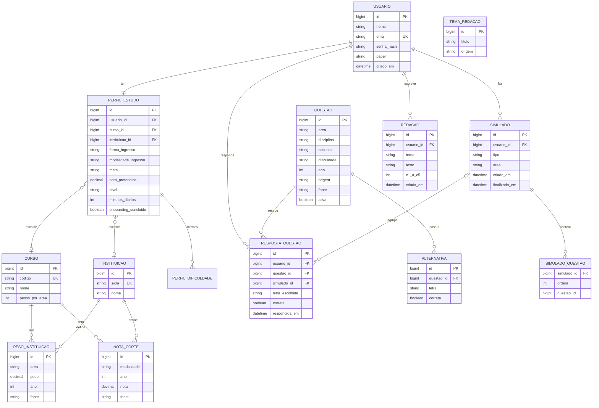

# Banco de dados

Esquema criado por migrações em `src/main/resources/db/migration` (V1 a V6). Diagrama (Mermaid):

Observações:
- `PESO_INSTITUICAO` e `NOTA_CORTE` começam **vazias**: só entram dados com ano e fonte reais.
- `QUESTAO.origem`: `ENEM_OFICIAL` (exige ano e fonte), `EXEMPLO` ou `AUTORAL`.
- `TEMA_REDACAO` não tem ligação com `REDACAO`: a redação guarda o título do tema como texto.
- Dados pessoais: `usuario` (nome, e-mail, senha com hash) e `redacao.texto`. Ver [AVALIACAO.md](AVALIACAO.md).
